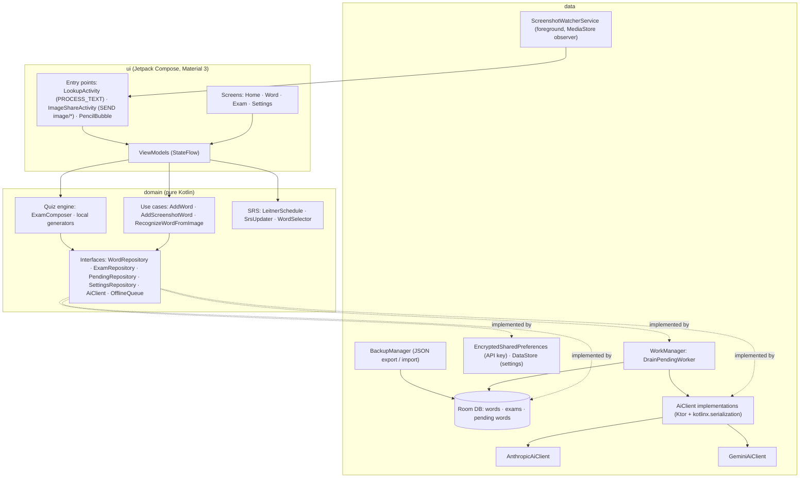

# AI Dictionary for Android

[](../../actions/workflows/android.yml)


[](LICENSE)

A personal, AI-powered English dictionary that starts empty and grows from the words *you* actually
stumble on. Select a word in any app, share a screenshot, or type it in — the app asks an LLM for a
compact dictionary article (plain-English explanation, Russian and Turkmen translations, examples,
synonyms, a common mistake), stores it locally, and then turns your vocabulary into spaced-repetition
exams that mix offline quiz types with AI-generated questions.

> **Status:** personal project, not published on Google Play. Build it from source to try it.

## Screenshots

<!-- TODO: add screenshots (home list, word article, text-selection popup, exam, settings).
     Suggested location: docs/screenshots/*.png, shown here in a 3-column table. -->

## Features

### Capture words from anywhere
- **Text-selection menu** — an `ACTION_PROCESS_TEXT` entry appears next to *Copy* in any app. A
  translucent card opens on top of the current app; if a whole sentence is selected you tap the
  word you mean and the sentence is kept as context.
- **Share an image** — share any picture or screenshot to the app, circle the word with your finger,
  and the crop goes through on-device ML Kit OCR first, falling back to the AI vision model for
  stylised or hand-written text.
- **Screenshot watcher** (opt-in) — a foreground service watches `MediaStore` for new screenshots
  and shows a floating pencil bubble (`SYSTEM_ALERT_WINDOW`) that opens the same crop editor.
- **Manual search-or-add** — one field searches the local dictionary instantly and offers "Ask AI"
  when the word is not there yet.

### AI word articles
- English explanation (CEFR ~B1), **Russian and Turkmen** translations, part of speech, IPA,
  2–3 examples translated into both languages, synonyms and a typical mistake.
- Context-aware: when a source sentence is known, the article explains the meaning used *there*.
- Duplicate detection by normalised term, with an option to look up a different sense.
- Text-to-speech pronunciation.

### Learning
- **Leitner spaced repetition** — 6 boxes with 0 / 1 / 3 / 7 / 16 / 35-day intervals, weighted word
  selection, and a *mastered* status that pushes well-known words out of exams (with occasional
  control checks).
- **Local quiz generators** (work offline): translation choice, reverse choice, example gap fill,
  letter scramble, audio choice (TTS).
- **AI-generated exams** — batched requests for gap fill, definition → word, find-the-mistake,
  synonym in context and mini-dialogue questions; invalid items are dropped and replaced by local
  ones so an exam never breaks on one bad question.
- **Open answers** — write your own sentence with the word; the AI returns a verdict, a correction
  and a short comment in your interface language.
- Exams survive process death and can be resumed; results link back to the word cards.

### Offline & privacy
- **Offline queue** — words added without a connection are stored as pending and explained by
  WorkManager as soon as the network is back.
- **Encrypted API key** — stored in `EncryptedSharedPreferences` (Android Keystore), never logged.
- **Local-first** — all data lives in an on-device Room database; only the word/sentence (or the
  image crop) is sent to the AI provider.
- **Backup** — export / import the dictionary, including SRS progress, to a JSON file.
- Request **usage counter** in Settings.
- UI in **English, Russian and Turkmen** (per-app language), light and dark themes.
- Without the screenshot watcher the app needs no dangerous permissions.

## Bring your own key

There is no backend. The app calls the AI provider directly with a key that you paste into
**Settings** (it can be verified with a test request and is stored encrypted on the device).

Two providers are implemented behind the same `AiClient` interface:

| Provider | Implementation | Models (`*Models.kt`) |
|---|---|---|
| Google Gemini | `GeminiAiClient` | `gemini-flash-latest` |
| Anthropic Claude | `AnthropicAiClient` | Haiku for articles, Sonnet for exams, vision and answer checking |

The active provider is chosen by a single Hilt binding in
[`di/AiModule.kt`](app/src/main/java/com/sozluk/ai/di/AiModule.kt) — Gemini is bound by default
(it has a free tier); switch the binding to `AnthropicAiClient` to use a Claude key.

> Keys in a client app are fine for personal use. For a public release the `AiClient` interface is
> designed so a small proxy backend can replace the direct calls without touching the rest of the app.

## Architecture

MVVM with three layers — `ui` → `domain` → `data` — wired together by Hilt. The domain layer is
plain Kotlin (models, use cases, repository/AI interfaces, quiz engine, SRS) and is where most unit
tests live.



### Key engineering decisions

- **`AiClient` interface with two providers.** Every AI call (article, image, quiz batch, answer
  check) goes through one domain interface. Anthropic and Gemini implementations share prompts and
  parsing; swapping providers — or putting a proxy in front — is a one-line DI change.
- **Strict JSON contracts.** Prompts demand JSON only. Replies are cleaned by stripping Markdown
  fences / surrounding text, decoded into typed models, retried **once** on invalid JSON (and once
  on network errors, 429 or 5xx), and otherwise surfaced as a typed `AiError`
  (`NoApiKey`, `InvalidKey`, `RateLimited`, `Network`, `InvalidResponse`, …) that the UI maps to a
  message with a retry action. AI quiz items are validated (answer index in range, no duplicate
  options) before use.
- **Offline queue via WorkManager.** A failed or offline lookup never loses the word: it is stored
  in a `pending_words` table and a unique, network-constrained work request drains the queue.
- **Room migrations with tests.** Schemas are exported to `app/schemas/`, and `MigrationTest`
  (instrumented) runs `MIGRATION_1_2` through `MigrationTestHelper`.
- **No AccessibilityService.** Capturing words relies only on platform-sanctioned entry points —
  `PROCESS_TEXT`, the share sheet and an opt-in screenshot observer — which keeps permissions
  minimal and avoids reading other apps' screens.
- **Offline-capable exams.** Exams mix locally generated and AI-generated questions; with no
  network (or no key) the exam is built entirely from local generators.

## Tech stack

| Area | Libraries |
|---|---|
| Language & build | Kotlin 2.3 (AGP built-in Kotlin), AGP 9.3, Gradle 9.5, KSP, version catalog |
| UI | Jetpack Compose, Material 3, Navigation Compose, SplashScreen, AppCompat per-app locales |
| DI | Hilt (incl. Hilt Work and Hilt Navigation Compose) |
| Persistence | Room (exported schemas + migrations), DataStore, `security-crypto` |
| Networking | Ktor client (OkHttp engine), kotlinx.serialization |
| Background | WorkManager, foreground service |
| On-device ML | ML Kit Text Recognition (Latin) |
| Testing | JUnit 4, kotlinx-coroutines-test, Turbine, MockK, Ktor MockEngine, Room testing |

## Project structure

```
app/src/main/java/com/sozluk/ai/
├── ui/            # Compose screens & ViewModels
│   ├── screens/   #   home · word · exam · settings
│   ├── lookup/    #   text-selection popup (PROCESS_TEXT)
│   ├── imageshare/#   share-image crop & OCR flow
│   ├── screenshot/#   floating pencil bubble
│   └── theme/ navigation/ common/
├── domain/        # Pure Kotlin
│   ├── ai/        #   AiClient, typed errors, contracts
│   ├── quiz/      #   ExamComposer + local generators
│   ├── srs/       #   Leitner schedule, updater, weighted selector
│   ├── usecase/   #   AddWord, AddScreenshotWord, RecognizeWordFromImage
│   └── model/ repository/ image/ text/ screenshot/ usage/ i18n/
├── data/          # Implementations
│   ├── ai/        #   Anthropic & Gemini clients, prompts, JSON extraction
│   ├── db/        #   Room entities, DAOs, migrations
│   ├── work/      #   offline queue worker
│   ├── prefs/     #   encrypted key store, settings, usage counter
│   ├── screenshot/#   watcher service
│   └── backup/ image/ quiz/ repository/
└── di/            # Hilt modules
app/schemas/       # exported Room schemas (used by migration tests)
docs/spec.md       # original product specification (Russian)
```

## Build, run and test

**Requirements:** JDK 21 (Android Studio's bundled JBR works) and the Android SDK (API 36).
Opening the project in a recent Android Studio is the easiest path; it creates `local.properties`
with your `sdk.dir` automatically.

```bash
# Unit tests (JVM)
./gradlew test

# Debug APK -> app/build/outputs/apk/debug/
./gradlew assembleDebug

# Install on a connected device / emulator
./gradlew installDebug

# Instrumented tests (Room DAOs and migrations) on a device / emulator
./gradlew connectedDebugAndroidTest
```

On Windows use `gradlew.bat`. From the command line, point `JAVA_HOME` at a JDK 21
(e.g. `C:\Program Files\Android\Android Studio\jbr`).

After installing, open **Settings**, paste your API key and tap **Check**. Optional extras:
enable the screenshot watcher (asks for notification, media and overlay permissions), and pick the
interface and native language.

CI runs unit tests and builds the debug APK on every push and pull request
([`.github/workflows/android.yml`](.github/workflows/android.yml)).

## License

[MIT](LICENSE) © Guvanch D.
